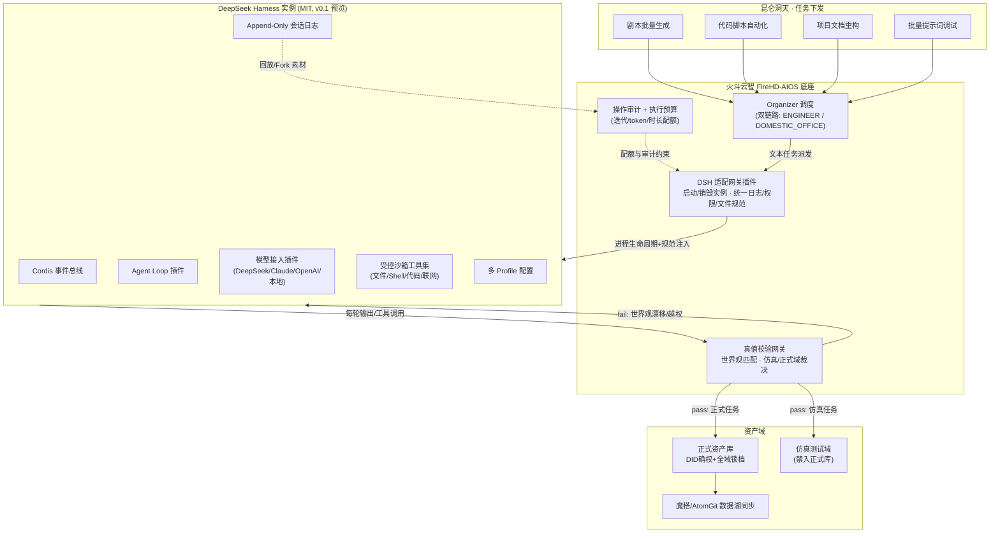

# 火斗云智集成 DeepSeek Harness 插件技术方案 V1.0

> 确权：DID-BR-000002 ｜ 溯源：Ω₀⊂⊙∞⊂Ω ｜ 节点：ZR-NODE-DC2E51C0
> 来源：《07_结论先行_复刻功能路线分析》（2026-10-22 真值注入）+ 外源网络交叉核验
> 状态：**建议态 proposed_for_adoption，部署需人工审批**（风险最小 > 成本最小 > 收益最大）
> 核验口径：DSH 版本/协议事实经网络核验；架构设计为推导建议，未经运行实测

---

## 〇、外源核验基线（2026-10-22）

| 事实 | 核验结果 | 来源 |
|---|---|---|
| DSH 开源、MIT 协议、可商用 | ✅ 确认（GitHub `deepseek-ai/deepseek-harness` LICENSE = MIT, Copyright 2026 DeepSeek） | raw.githubusercontent.com |
| 开发者预览版 v0.1（0.1.2-rc.1） | ✅ 确认，2026-08-13 发布，TypeScript，npm `@deepseek-ai/dsh` | 多源一致 |
| 兼容性破坏变更 / 未做安全审计 | ✅ 官方自述 "Compatibility-breaking changes. Not security-audited." | harness-deepseek.org |
| 风险提示"许可证变更影响" | ⚠️ 修正：MIT 为不可撤销许可，**存量版本商用权不受未来改协议影响**；风险仅在"新特性跟随"层面 | 许可证法理 |

## 一、结论先行

1. **功能层面无技术壁垒，六项能力全部可复刻**（微内核插件体系 / Agent 循环 / 多模型接入 / 受控沙箱 / Append-Only 会话日志 / 多 Profile）。
2. **不从零照搬**，最优解为融合架构：**兼容 Harness 能力 + 保留自有体系独有优势**（真值校验网关、仿真/正式域隔离、DID 确权锁档）。
3. **短期路线 A（桥接集成）→ 中长期路线 B（原生自研兼容层）** 两步走。
4. 复刻 ≠ 照搬：DSH 无世界观约束层、无仿真/正式域隔离——这两层是火斗云智**不可外求**的原生差异层。

## 二、六项能力复刻映射（全部可实现）

| # | DSH 能力 | Cordis 本质 | ZONGYUAN-ROOT 对应与改造量 |
|---|---|---|---|
| 1 | 微内核插件体系 | 事件总线 + 依赖注入 + 插件生命周期 | 已有事件调度机制；扩展标准化插件协议（模型/工具/存储/Agent循环/UI 可插拔），配置文件组装智能体，不改内核 |
| 2 | Agent Loop 插件化 | 规划→推理→工具→校验→终止 | 增加断点续跑 + 执行预算（最大迭代/token 上限/运行时长），对齐 L3 任务调度层配额管控 |
| 3 | 多模型统一接入层 | 统一消息封装、流式输出 | ≈ L4 多模型混合资产池既有 API 路由，扩流式协议 |
| 4 | 受控工具集沙箱 | 文件/Shell/代码/联网，权限分级 | ≈ L2 算子三态隔离 + AxiomGate 权限裁决，补操作审计 |
| 5 | Append-Only 会话日志 | 每轮推理/工具/事件快照，可回放 Fork | ≈ 链块 append-only + SHA256 确权既有范式，扩任务回放/分支 |
| 6 | 多 Profile 环境配置 | 标准/代码/极简/创作多套配置 | ≈ 双链路（ENGINEER/DOMESTIC_OFFICE）扩展为多 Profile |

## 三、两路线对比与选择

| 维度 | 路线 A：DSH 桥接插件（短期 0–3 月，推荐先行） | 路线 B：原生自研兼容层（中长期 6–12 月） |
|---|---|---|
| 成本 | 短，复用官方稳定代码 | 高，复刻插件生命周期/依赖解析/事件模型/循环/沙箱 |
| 迭代 | 跟随官方 | 完全自主、私有化 |
| 内核 | **两层内核**（ZONGYUAN-ROOT + Cordis），需桥接网关同步权限/日志/资产规范 | 单一内核统一事件总线 |
| 能力打通 | 与多模态渲染解耦，文本/视觉两管线并行 | 文本 Agent 直调底座图像生成/锁帧/视频渲染 |
| 独有治理 | 需外挂真值网关 | 原生内建 IP 世界观校验、资产确权 |
| 结论 | **先行落地**：昆仑洞天下发文本任务 → FireHD 调度调用 DSH → 代码自动化/文本规划 → 结果回流资产库 | **终态**：淘汰外部依赖，文本智能体与多模态渲染共享同一事件总线与真值规则 |

**两步走迁移判据（建议）**：当桥接网关维护成本 > 自研兼容层 3 个月投入，或 DSH 协议破坏性变更导致桥接连续返工时，启动路线 B。

## 四、路线 A 架构拓扑（Mermaid）

**关键约束（写死在桥接网关，不可配置绕过）**：
1. DSH 所有输出必须过真值校验网关才能触达资产域；
2. 仿真任务产物物理路径隔离，无法写入正式资产库；
3. 所有落盘文件自动附加 DID 确权元数据；
4. 沙箱越权即熔断回传，不得静默降级。

## 五、路线 B 融合形态（终态一句话）

> 火斗云智复刻版 = DeepSeek Harness 全部能力 + IP 内容生产专属治理层
> （真值校验网关 + 仿真/正式域隔离 + DID 确权锁档 + IP 世界观校验，全部原生内建于 ZONGYUAN-ROOT 单一事件总线）

## 六、实施计划（建议态）

**短期 0–3 月【路线 A】DSH 适配网关插件**
- A1 桥接网关：DSH 实例启动/销毁封装 + 权限/日志/文件存储规范统一（对齐昆仑洞天脚本与资产目录）
- A2 真值网关挂接：每轮输出过校验，仿真/正式分域落盘
- A3 场景试点：剧本批量生成 → 代码自动化 → 文档重构 → 提示词调试（按资产主线优先级排序）
- A4 每阶段先锁档再推进，部署动作人工审批

**中长期 6–12 月【路线 B】原生自研兼容层**
- B1 吸收 Cordis 设计思想：事件总线 + 依赖注入 + 插件生命周期，原生融入 ZONGYUAN-ROOT
- B2 文本智能体与多模态渲染引擎共享同一事件总线与真值规则
- B3 淘汰外部依赖，DSH 协议破坏性变更风险归零

## 七、风险与边界（含核验修正）

1. **R1 DSH v0.1 预览期协议变动**：官方自述兼容破坏性变更、未安全审计 → 桥接层须做版本钉固 + 契约探测（可复用 steady_evolve 端点契约范式）；MIT 存量商用权不受未来改协议影响（修正原分析）。
2. **R2 沙箱越权**：集成与自研同难度核心点 → 权限隔离 + 真值网关 + 操作审计三重闸，Agent 禁改生产资产。
3. **R3 资源错配**：核心赛道是 IP 多模态工业化生产，通用代码 Agent 为辅助 → 资源优先保障视觉生成主线，不盲目完全对标 DSH。
4. **R4 双内核治理成本**：路线 A 的本质代价，须监控并在触发判据时切换路线 B。

## 八、配套产物与锁档

- 本方案文档：`04_PROJECTS/技术报告/火斗云智集成DeepSeek-Harness技术方案-V1.0.md`（含 Mermaid 拓扑）
- JSON 卷宗：`04_PROJECTS/技术报告/DOSSIER-DSH-INTEGRATION-V1.0.json`
- 种子真值：`SEED-DSH-REPLICATE-ROUTE-20261022.json`（5 条，网关回执见链块）
- 状态：全部为建议态，**推进与否需人工决策，部署需人工审批**
